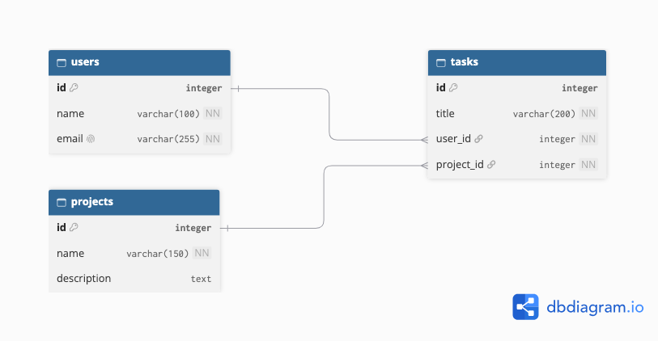

# TaskBridge — ERD Design and PostgreSQL Schema

## Project Overview

This project contains a corrected Entity Relationship Diagram (ERD) and PostgreSQL database schema for TaskBridge.

The database contains three main entities:

- Users
- Projects
- Tasks

## Note About the Original ERD

The assessment material available to me listed the three entities but did not include the original ER diagram or its attributes. Therefore, this submission presents a corrected database design based on the stated requirements.

## Database Design

### 1. Users

| Column | Data Type | Constraints |
|---|---|---|
| id | SERIAL | Primary Key |
| name | VARCHAR(100) | NOT NULL |
| email | VARCHAR(255) | UNIQUE, NOT NULL |

### 2. Projects

| Column | Data Type | Constraints |
|---|---|---|
| id | SERIAL | Primary Key |
| name | VARCHAR(150) | NOT NULL |
| description | TEXT | Optional |

### 3. Tasks

| Column | Data Type | Constraints |
|---|---|---|
| id | SERIAL | Primary Key |
| title | VARCHAR(200) | NOT NULL |
| user_id | INTEGER | NOT NULL, Foreign Key |
| project_id | INTEGER | NOT NULL, Foreign Key |

## Relationships

- One user can be assigned multiple tasks.
- One project can contain multiple tasks.
- Each task belongs to one user.
- Each task belongs to one project.

## Constraints Used

- PRIMARY KEY: Uniquely identifies each record.
- FOREIGN KEY: Connects tasks with users and projects.
- NOT NULL: Prevents required fields from being empty.
- UNIQUE: Prevents duplicate user email addresses.

## Corrected ER Diagram



## PostgreSQL Setup

Create the database:

```sql
CREATE DATABASE taskbridge;
```

Connect to the database:

```sql
\c taskbridge
```

Execute the schema file:

```sql
\i 'schema.sql'
```

## Verification Commands

```sql
\dt
\d users
\d projects
\d tasks
```

All three tables were successfully created and verified in PostgreSQL.

## Technologies Used

- PostgreSQL
- SQL
- dbdiagram.io
- GitHub